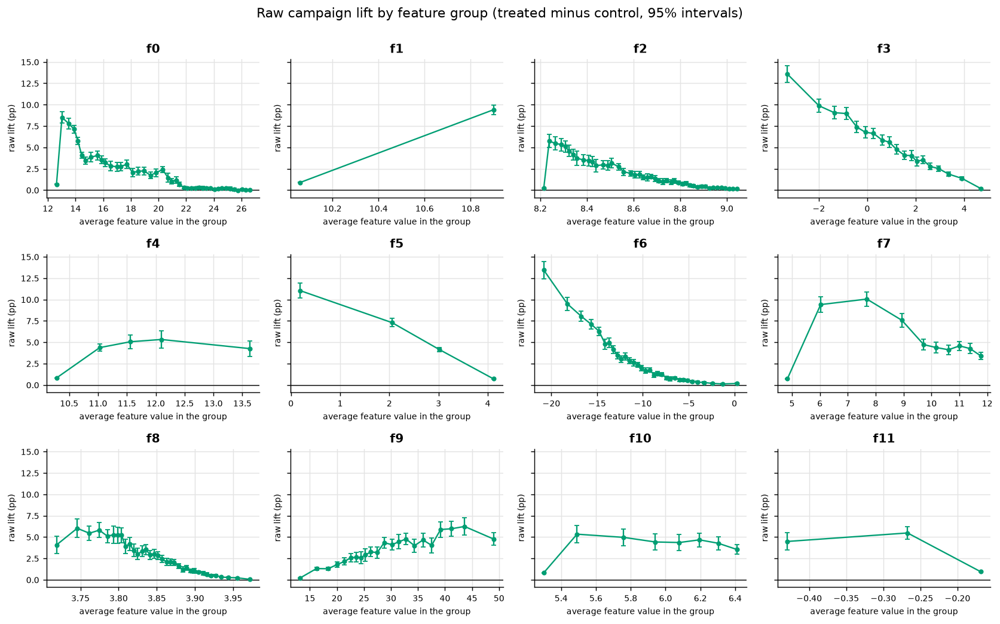

# Experimentation Toolkit: Did the Ad Campaign Work?

> **One-line pitch:** A tested Python toolkit for A/B tests, used on a real 14-million-person ad experiment to answer three questions: did the ad work, can we trust the test, and who should see the ad?

## What is this project?

Companies run experiments to decide things: does this ad, email or button make more people visit or buy? A good decision takes more than "the new version has a higher number". You need to know how many people to test, whether the test ran as designed, how much of the difference is real, and what to do when the answer is "not sure yet".

I packaged those steps as a small library (`expkit`) and ran it end to end on the public **Criteo uplift dataset**: 14 million people, most of them shown an ad campaign and a smaller group held back as a comparison. The project ends with a one-page recommendation memo (ship, do not ship, or run longer) and five Jupyter notebooks that explain every step with charts. It is an independent portfolio project, not affiliated with Criteo.

## The results, in plain English

<!-- HEADLINE:START -->
**What was tested.** 13,979,592 people in a Criteo advertising experiment were randomly split: 85% could see an ad campaign (the *treatment* group) and the rest were held back for comparison (the *control* group). The question: does the campaign make more people visit the advertiser's website?

**What happened, in plain words**

- **Did the ad work?** Yes. Out of every 1,000 people who were not shown the campaign, about 40.4 visited. With the campaign, about 47.8 did. That is roughly **7.5 extra visits per 1,000 people** (+0.75 pp; a *percentage point* is one visit per 100 people). The true value is very likely between 7.1 and 7.8 per 1,000.
- **Can we trust the experiment?** Mostly. The group sizes matched the plan (check passed). But the two groups were not perfectly alike: a model could tell who got the ad slightly better than a coin flip (score 51.1%, where 50% means a perfectly fair split). So the plain difference between the groups (+1.03 pp) is a little too high, and this project reports the corrected figure (+0.75 pp) instead.
- **Should the company ship it?** The decision rule says **ship**. It compares the result with a bar for 'worth the cost': at least +0.50 pp extra visits. That bar is a placeholder, because the dataset has no costs or revenue. The answer depends on that bar: a higher bar would turn it into 'run longer' or 'do not ship' (see notebook 02).
- **Who should see the ad?** Not everyone responds equally. Showing it only to the top 10% of people ranked by a targeting model (S-learner (LightGBM)) reaches 59% of all the extra visits. Simply picking the people most likely to visit anyway reaches 51%. The model is better, but not by a huge margin.
- **Does the toolkit itself work?** When one group was split in two at random (so there is truly no difference), the test wrongly claimed a difference 4.7% of the time, close to the 5% it promises. Using each user's features to remove noise (CUPAC) made the estimate 30.5% less noisy, like getting that much more data for free.
<!-- HEADLINE:END -->

Every number above is written by code from `docs/results/results.json`; none is typed by hand. The full tables are in [docs/RESULTS.md](docs/RESULTS.md) and the one-page decision memo is [docs/MEMO.md](docs/MEMO.md).



*The campaign helps some kinds of users much more than others, which is why targeting is worth testing.*


*The simple difference between the groups is higher than the corrected estimate, because the groups were not perfectly alike.*


*What the ship / run longer / do not ship rule says for different "worth the cost" bars.*


*Targeting: the further a curve rises above the diagonal (treating people at random), the better the model finds people the ad actually changes.*

## Tech stack

- **Language:** Python 3.12 or 3.13
- **Data and SQL:** DuckDB (all data preparation is SQL in [`sql/`](sql)), pandas, NumPy
- **Statistics and modeling:** SciPy, scikit-learn, LightGBM, EconML (causal forest)
- **Notebooks and charts:** Jupyter, Matplotlib
- **App and tooling:** Streamlit (sample size calculator), pytest, ruff, GitHub Actions

## Quick start

```bash
git clone https://github.com/VanshikaGurbani/experimentation-toolkit.git
cd experimentation-toolkit
python -m venv .venv
.venv/Scripts/python -m pip install -e ".[causal,serve,dev,notebooks]"   # macOS or Linux: .venv/bin/python
```

```bash
expkit fetch-data      # downloads Criteo (about 311 MB) and Hillstrom (about 4 MB) into data/raw
expkit run-all         # about 8 minutes on a 16-core machine; writes docs/ and the results above
pytest                 # runs the tests; no data download needed
streamlit run app/streamlit_app.py   # the sample size calculator
```

The notebooks are already saved with their outputs, so you can open them in GitHub or VS Code without running anything. To re-run them on your machine: `expkit run-notebooks`.

## The notebooks

| Notebook | The question it answers |
|---|---|
| [01 EDA of the Criteo data](notebooks/01_eda_criteo.ipynb) | What is in the file, how rare are visits, and do treated and control users look alike? |
| [02 Validity and effect](notebooks/02_experiment_validity_and_effect.ipynb) | Can we trust the experiment, how big is the lift, and how does the decision depend on the bar? |
| [03 CUPED, power and A/A](notebooks/03_cuped_power_and_aa.ipynb) | How much noise can be removed, how many users are needed, and does the test keep its promises? |
| [04 Uplift and targeting](notebooks/04_uplift_and_targeting.ipynb) | Who should see the campaign? |
| [05 Hillstrom sanity check](notebooks/05_hillstrom_sanity.ipynb) | Does the toolkit work on a second experiment, and where did the noise removal not help? |

Each notebook starts with a plain-English question and ends with "what this means" and "what is weak" notes. All charts use a colour-blind-safe palette and are saved in [`docs/figures/`](docs/figures).

## What is in the toolkit

| Piece | Module | What it does |
|---|---|---|
| Power and sample size | `expkit/power.py` | How many users per arm to detect a given effect, or what a given sample can detect. |
| Sample ratio check | `expkit/srm.py` | Checks the groups are the size the design promised. |
| Balance check | `expkit/balance.py` | Can the features predict who got the ad? In a fair test they cannot. |
| Confidence intervals | `expkit/inference.py` | Difference in rates with 95% intervals. |
| Adjusted effect | `expkit/adjust.py` | Doubly robust (AIPW) estimate that corrects for imbalance between groups. |
| Variance reduction | `expkit/cuped.py` | CUPED and CUPAC: a tighter interval from the same users. |
| Decision rule | `expkit/decision.py` | SHIP, DO NOT SHIP, RUN LONGER or INVALID. |
| Uplift models | `expkit/uplift.py` | S-learner, T-learner, a "likely to visit" baseline, and a causal forest. |
| Qini curve | `expkit/qini.py` | Scores targeting models, with bootstrap intervals. |

## The hardest part

The Criteo experiment is described as randomized, and the sample ratio check agrees (the split matches the plan almost exactly). But a model could still guess who got the ad from the 12 features slightly better than chance. That means the plain difference between the groups mixes the real effect of the ad with a small difference in who was in each group, and it overstates the lift. I handled it with a rule fixed in the code: if the balance check flags, the corrected (doubly robust) estimate is the headline, and the raw one is shown only for comparison. Getting this right also meant testing every statistic against a second library or a simulation, so the project does not just trust its own code.

## How it was tested

- Unit tests check each statistic against a textbook value, a second library (statsmodels, SciPy) or a simulation. For example, the 95% intervals cover the truth about 95% of the time.
- Leak checks: shuffling treatment labels destroys the uplift signal, and the post-assignment `exposure` column is never used as a feature.
- Checks on the real data: an A/A test and a power calibration (see [docs/RESULTS.md](docs/RESULTS.md)).
- Tests also confirm the committed notebooks ran on the real data with no errors. CI runs all five notebooks on a small synthetic dataset on every push.

## Limitations

- **Assigned, not necessarily seen.** Only a small share of treated users actually saw the ad, so the estimates are the effect of being assigned to the campaign.
- **No costs or revenue.** The "worth the cost" bar behind the ship decision is an assumption in `expkit/config.py`, and the memo shows how the call changes with it.
- **Targeting gains are modest.** The best model beats the simple baseline by a small amount, and the T-learner does not beat it.
- **One experiment, one period.** No novelty, fatigue or seasonality checks are possible.
- **The notebooks show one run** on one machine with one seed. Re-running them needs the data downloaded and `expkit run-all` finished first.
- **The calculator is not deployed.** It uses a normal approximation, so very small samples or rates near 0% or 100% need exact methods.

## Data and licence

The code is released under the MIT licence ([LICENSE](LICENSE)). The datasets are **not included** and keep their own licences.

- **Criteo Uplift Modeling Dataset v2.1** (Diemert et al., 2018), 13,979,592 rows, CC BY-NC-SA 4.0 (non-commercial, share-alike), downloaded from the public mirror `criteo/criteo-uplift` on Hugging Face.
- **Hillstrom MineThatData email test** (2008), 64,000 customers, used only to show noise removal with a true pre-period metric.

## Repository layout

```
expkit/      the package: power, srm, balance, inference, adjust, cuped, decision, uplift, qini,
             experiment (the pipeline), report (writes the docs), notebook helpers, cli
sql/         the DuckDB SQL: load, split, summaries, balance, deciles
app/         Streamlit calculator
notebooks/   five Jupyter notebooks, committed with outputs
tests/       pytest suite (synthetic data only)
docs/        RESULTS.md and MEMO.md (generated), results/ (results.json), figures/ (PNG charts)
```
