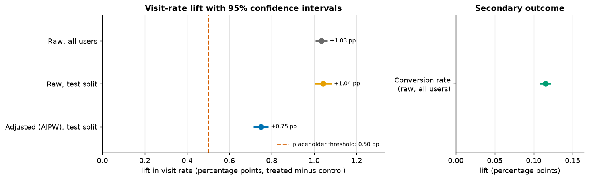
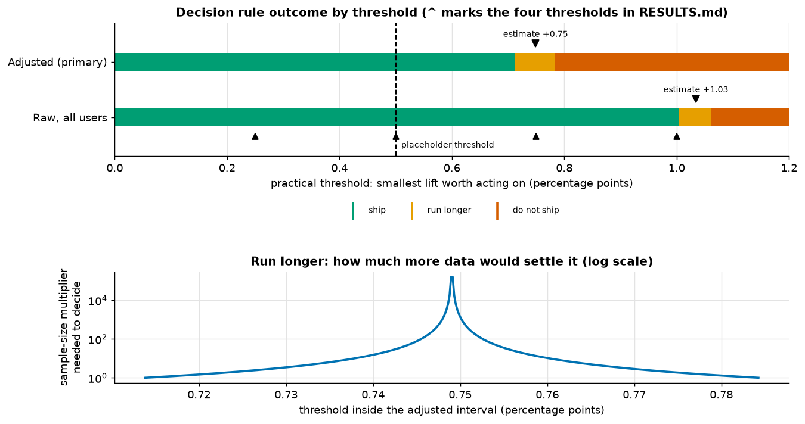
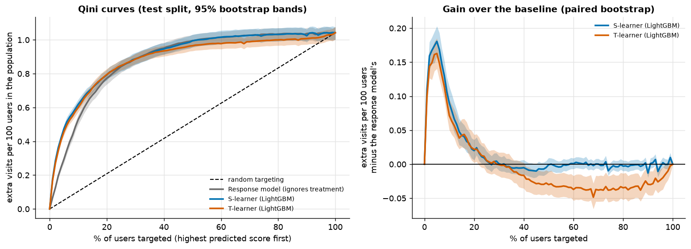

# Experimentation Toolkit

A tested Python toolkit for A/B tests (sample size, validity checks, adjusted effect, variance reduction, ship/no-ship decision, uplift targeting), applied end to end to a 14-million-user ad experiment from Criteo.

## Overview

`expkit` packages the steps of a rigorous A/B test analysis as a reusable library: power and sample size, sample ratio mismatch (SRM) and balance checks, confidence intervals, a doubly robust adjusted effect, CUPED variance reduction, a decision rule, and uplift models for targeting. The project runs the whole workflow on the public **Criteo uplift dataset** and ends with a one-page decision memo ([docs/MEMO.md](docs/MEMO.md)) and five notebooks with EDA and charts.

Independent portfolio project, not affiliated with Criteo.

## Results

<!-- HEADLINE:START -->
**Setup.** 13,979,592 users in the Criteo uplift experiment: 85% assigned to an ad campaign, the rest held out as control. Outcome: visiting the advertiser's website.

- **Effect:** the campaign raised the visit rate from 4.04% to 4.78%, a lift of **+0.75 pp** (95% CI +0.71 to +0.78 pp), about 7.5 extra visits per 1,000 users.
- **Validity:** the sample ratio check passed, but a model can predict assignment from the features (AUC 51.1%; 50% is a clean experiment). The covariate-adjusted lift is therefore the headline, and the raw difference of +1.03 pp overstates it.
- **Decision:** **ship**, against a placeholder minimum worthwhile lift of +0.50 pp (the data has no cost or revenue). The call changes at higher thresholds (notebook 02).
- **Targeting:** treating only the top 10% of users ranked by the S-learner (LightGBM) captures 59% of the extra visits, against 51% for ranking by likelihood to visit.
- **Toolkit checks:** the A/A false positive rate measured 4.7% against 5% expected, and CUPAC cut the variance of the lift estimate by 30.5%.
<!-- HEADLINE:END -->

All numbers are written by code from `docs/results/results.json`. Full tables: [docs/RESULTS.md](docs/RESULTS.md).








## Tech stack

- **Language:** Python 3.12 / 3.13
- **Data:** DuckDB (SQL in [`sql/`](sql)), pandas, NumPy
- **Modeling:** SciPy, scikit-learn, LightGBM, EconML
- **Notebooks and charts:** Jupyter, Matplotlib
- **App and tooling:** Streamlit, pytest, ruff, GitHub Actions

## Toolkit

| Piece | Module | What it does |
|---|---|---|
| Power and sample size | `expkit/power.py` | Users per arm for a given effect, or the effect a sample can detect. Handles unequal splits. |
| Sample ratio check | `expkit/srm.py` | Chi-square test that arm sizes match the design. |
| Balance check | `expkit/balance.py` | Classifier AUC for predicting assignment from features. |
| Confidence intervals | `expkit/inference.py` | Absolute and relative lift with 95% intervals. |
| Adjusted effect | `expkit/adjust.py` | Doubly robust (AIPW) estimate. |
| Variance reduction | `expkit/cuped.py` | CUPED and CUPAC. |
| Decision rule | `expkit/decision.py` | SHIP, DO NOT SHIP, RUN LONGER or INVALID, with guardrail metrics. |
| Uplift models | `expkit/uplift.py` | S-learner, T-learner, response-model baseline, causal forest. |
| Qini curve | `expkit/qini.py` | Targeting evaluation with bootstrap intervals. |
| Calculator | `app/streamlit_app.py` | Streamlit sample size calculator. |

## Notebooks

Saved with outputs, run on the real data. Each opens with the question it answers and closes with "what this means" and "what is weak" notes.

| Notebook | Covers |
|---|---|
| [01 EDA](notebooks/01_eda_criteo.ipynb) | Data dictionary, missingness, outcome rates, feature distributions by arm, standardized mean differences, correlation heatmap |
| [02 Validity and effect](notebooks/02_experiment_validity_and_effect.ipynb) | SRM, balance AUC, raw vs adjusted lift, decision threshold sensitivity |
| [03 CUPED, power and A/A](notebooks/03_cuped_power_and_aa.ipynb) | Variance reduction, sample size, A/A false positives, power calibration |
| [04 Uplift and targeting](notebooks/04_uplift_and_targeting.ipynb) | Qini curves with bootstrap bands, capture shares, uplift by decile, causal forest |
| [05 Hillstrom](notebooks/05_hillstrom_sanity.ipynb) | The same toolkit on a second experiment |

## Quick start

```bash
git clone https://github.com/VanshikaGurbani/experimentation-toolkit.git
cd experimentation-toolkit
python -m venv .venv
.venv/Scripts/python -m pip install -e ".[causal,serve,dev,notebooks]"   # macOS or Linux: .venv/bin/python
```

```bash
expkit fetch-data      # downloads Criteo (about 311 MB) and Hillstrom (about 4 MB) into data/raw
expkit run-all         # about 8 minutes on a 16-core machine; writes docs/ and the results above
expkit run-notebooks   # optional: re-run the notebooks on the real data
pytest                 # no data download needed
streamlit run app/streamlit_app.py
```

`expkit run-all --fixture` and `expkit run-notebooks --fixture --out DIR` run on a small synthetic dataset (this is what CI does).

## Hardest part

The Criteo data is described as randomized and the SRM check agrees, yet a model can still predict assignment from the 12 features slightly better than chance. The raw difference between arms then mixes the ad's effect with a small difference in who is in each arm, and overstates the lift. The fix was a rule fixed in code: when the balance check flags, the doubly robust estimate is the headline and the raw one is shown only for comparison. Every statistic is tested against a second library or a simulation so the pipeline does not simply trust its own code.

## Testing

- Unit tests compare each statistic with a textbook value, statsmodels or SciPy, or a simulation (95% intervals cover the truth about 95% of the time; the SRM check false-alarms at its stated rate; CUPED leaves the estimate unbiased).
- Leak checks: shuffled treatment labels destroy the uplift signal; the post-assignment `exposure` column is never a feature; train, validation and test rows never overlap.
- Real-data checks: an A/A test and a power calibration ([docs/RESULTS.md](docs/RESULTS.md)).
- The committed notebooks are checked for errors and for matching the pipeline's numbers, and CI runs all five on a synthetic dataset.

## Limitations

- Intent to treat: only a small share of treated users saw the ad, so estimates are the effect of assignment.
- The practical threshold behind the ship decision is an assumption in `expkit/config.py`; there are no cost or revenue data.
- Uplift gains over the likelihood-to-visit baseline are modest, and the T-learner does not beat it.
- One experiment, one period: no novelty, fatigue or seasonality checks.
- The notebook outputs come from one run with one seed.
- The calculator uses a normal approximation and is not deployed.

## Data and licence

Code: MIT ([LICENSE](LICENSE)). The datasets are not included and keep their own licences.

- **Criteo Uplift Modeling Dataset v2.1** (Diemert et al., 2018), 13,979,592 rows, CC BY-NC-SA 4.0, from the `criteo/criteo-uplift` mirror on Hugging Face.
- **Hillstrom MineThatData email test** (2008), 64,000 customers.
