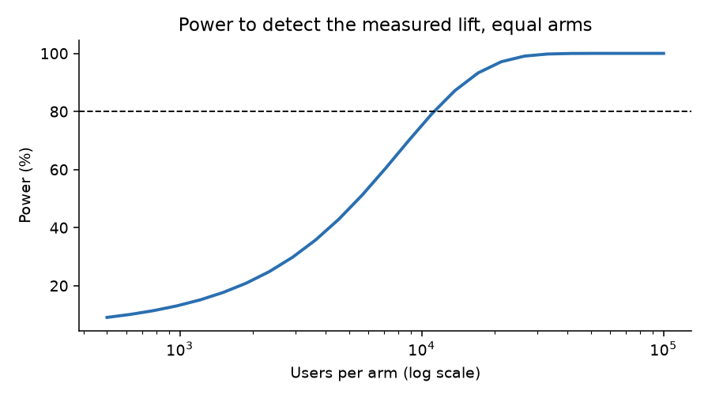
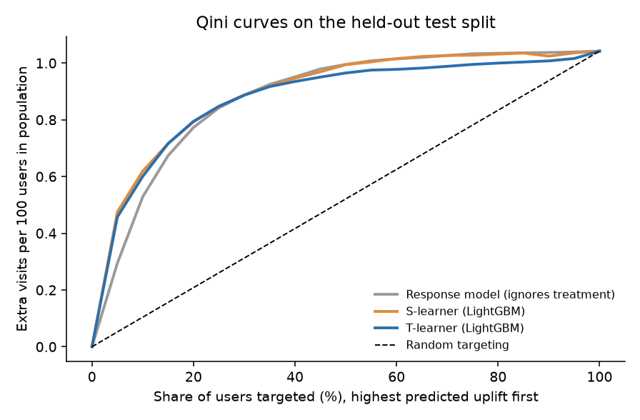
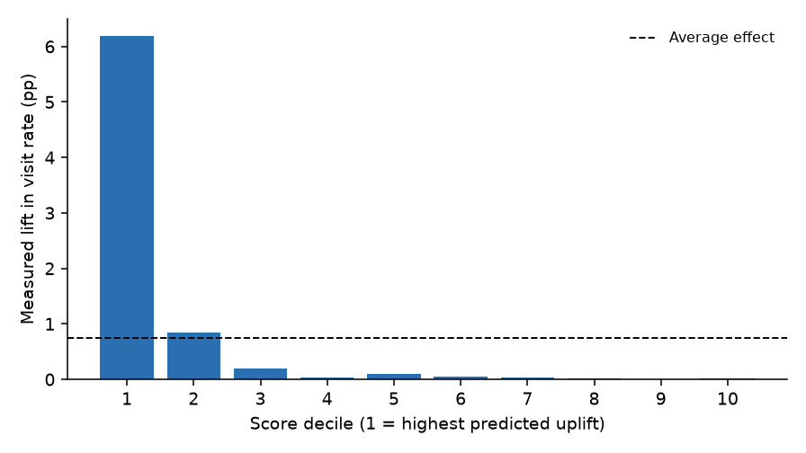

# Results

Generated by `expkit run-all` from `docs/results/results.json`. Do not edit by hand: every number below was produced by code.

- Dataset: **Criteo Uplift v2.1**, 13,979,592 users
- Code version: `41db89a7d7`, Python 3.13.5, seed 42
- Packages: numpy 2.5.4, pandas 3.1.1, scipy 1.18.1, scikit-learn 1.9.1, duckdb 2.0.0, lightgbm 4.7.0, econml 0.17.0
- Full run time: 8.2 minutes

## 1. Is the experiment trustworthy?

| Arm | Users | Share | Visits | Conversions | Saw the ad |
|---|---|---|---|---|---|
| Control | 2,096,937 | 15.00% | 80,105 | 4,063 | n/a |
| Treatment | 11,882,655 | 85.00% | 576,824 | 36,711 | 428,212 (3.60%) |

**Sample ratio mismatch (SRM).** Designed split 15% control and 85% treatment. Chi-square = 0.000, p = 0.9989, alarm threshold p < 0.001. Result: **passes**. The 85% / 15% design is the dataset's documented allocation, so it is an assumption about the design, not something the file proves.

How well would this check catch lost data (counts-only arithmetic):

| Total users | Treated users lost | p-value | Flagged |
|---|---|---|---|
| 13,979,592 | 0.1% | 0.1816 | no |
| 13,979,592 | 1.0% | 5.44e-41 | yes |
| 20,000 | 1.0% | 0.6121 | no |
| 20,000 | 10.0% | 1.30e-07 | yes |

**Randomization balance.** Largest absolute standardized mean difference across the 12 features: 0.0488 (values under 0.1 are usually read as balanced). That summary hides a subtler problem. A LightGBM model trained on the train split to predict who was treated from the 12 features reaches an AUC of **51.08%** on the test split (6,991,697 users); a clean randomized experiment gives 50%. The standard error of the AUC under pure randomization is 0.031%, so z = 35.2 and p < 1e-300. Balance check at p < 0.001: **FLAGGED**. The imbalance is small in size (the model barely beats a coin flip) but far beyond chance, and it matters because the users who differ are not equally likely to visit.

## 2. What did the treatment do?

Intent-to-treat: every user assigned to treatment is counted, whether or not they saw the ad. A pre-specified rule picks the primary estimate: if the balance check above flags, the covariate-adjusted estimate is primary, otherwise the raw difference is. Basis used here: **adjusted**. The adjusted estimate is a doubly robust AIPW estimate computed on the test split with models fitted on the train split; the raw difference in means uses all users.

| Metric | Control | Treatment | Absolute lift (95% CI) | Relative lift (95% CI) | p-value |
|---|---|---|---|---|---|
| Visit rate, raw difference | 3.820% | 4.854% | +1.034 pp (+1.006 to +1.063 pp) | +27.1% (+26.2% to +28.0%) | < 1e-300 |
| Visit rate, covariate-adjusted (AIPW) | 4.035% | 4.784% | +0.749 pp (+0.714 to +0.784 pp) | +18.6% (+17.6% to +19.6%) | < 1e-300 |
| Conversion rate, raw difference (secondary) | 0.194% | 0.309% | +0.115 pp (+0.108 to +0.122 pp) | +59.4% (+54.4% to +64.7%) | < 1e-300 |

The raw lift is +1.034 pp and the adjusted lift is +0.749 pp: adjusting lowers the estimate by 0.285 pp, which is 15.8 times the larger of the two standard errors (under clean randomization the two should agree within about 2). The conversion rate has no adjusted estimate in this run, so it is shown raw and should be read with the same caution.

**Decision rule.** Practical threshold (assumption, see `expkit/config.py`): +0.50 pp on visit rate. The rule ships only if the whole 95% interval is at or above the threshold, does not ship if the whole interval is below it, and otherwise runs longer. On the primary (adjusted) estimate: **ship**; on the raw estimate: **ship**. With the conversion rate as a guardrail (no drop allowed): **ship**.

How the decision depends on the threshold:

| Threshold (visit rate lift) | Decision on primary estimate | Data scale needed if undecided | Decision on raw estimate |
|---|---|---|---|
| +0.25 pp | ship | n/a | ship |
| +0.50 pp | ship | n/a | ship |
| +0.75 pp | run longer | more than 100x (effectively undecidable) | ship |
| +1.00 pp | do not ship | n/a | ship |

## 3. Power and sample size calculator

Baseline = control visit rate 3.820%, two-sided alpha 5%, power 80%. The real experiment used an 5.67:1 treatment to control allocation, so totals are shown for a 50/50 split and for the actual ratio.

| Effect to detect | Absolute | Users per arm (50/50) | Total (50/50) | Total (85/15) |
|---|---|---|---|---|
| 0.5 percentage points | +0.500 pp | 24,516 | 49,032 | 97,681 |
| measured lift (raw) | +1.034 pp | 6,088 | 12,176 | 24,601 |
| measured lift (adjusted) | +0.749 pp | 11,243 | 22,486 | 45,107 |
| 10% relative | +0.382 pp | 41,416 | 82,832 | 164,447 |

With the actual arm sizes (2,096,937 control, 11,882,655 treatment) the smallest lift this experiment could detect with 80% power is +0.040 pp.

## 4. Do the toolkit's own checks hold up on real rows?

**A/A test.** The treated arm was split at random into two halves of 20,000 users, 2,000 times. The test at 5% should reject about 5% of the time. Measured false positive rate: **4.7%** (95% CI 3.9% to 5.7%).

**Power calibration.** Samples of the calculator's size were drawn from the real arms:

| Case | Users per arm | Power from the formula | Measured power | 95% CI of measured | Draws |
|---|---|---|---|---|---|
| planned n | 6,088 | 80.0% | 80.5% | 78.7% to 82.1% | 2,000 |
| half of planned n | 3,044 | 50.8% | 51.9% | 49.8% to 54.1% | 2,000 |

The formula's inputs are the measured control rate and the measured lift, treated as the truth for this check.

**Decision rule over repeated experiments.** Samples were drawn from the real arms at multiples of the planned size (6,088 users per arm, 80% power for the measured lift). The practical threshold is +0.50 pp.

| Users per arm | Ship | Run longer | Do not ship | Draws |
|---|---|---|---|---|
| 6,088 | 33.0% | 66.9% | 0.1% | 1,000 |
| 24,352 | 79.6% | 20.4% | 0.0% | 1,000 |
| 97,408 | 100.0% | 0.0% | 0.0% | 1,000 |

Being powered to detect the effect is not the same as being powered to clear a practical threshold: at the planned size the interval is usually still too wide to settle the decision.

## 5. CUPED variance reduction

**Criteo, held-out test split (6,991,697 users), outcome = visit.** The file has no pre-experiment version of the outcome, only 12 anonymized features, so the covariates are those features (linear) or a LightGBM prediction of visit trained on the train split (CUPAC). Adjustment weights were fitted on other splits.

| Method | Lift estimate | 95% CI | Standard error | Variance reduction | Sample needed vs no adjustment |
|---|---|---|---|---|---|
| No adjustment | +1.042 pp | +1.002 to +1.083 pp | 0.0207% | n/a | 100% |
| CUPED, linear on f0 to f11 | +0.701 pp | +0.666 to +0.737 pp | 0.0179% | 25.0% | 75.0% |
| CUPAC, LightGBM prediction of visit | +0.636 pp | +0.603 to +0.670 pp | 0.0172% | 30.5% | 69.5% |

Under clean randomization CUPED leaves the estimate where it was and only narrows the interval (the unit tests confirm this on simulated data). Here the estimate also moved: CUPED, linear on f0 to f11 shifted it by -0.341 pp; CUPAC, LightGBM prediction of visit shifted it by -0.406 pp, against a standard error of 0.021% for the raw estimate. That is the covariate imbalance from section 1 showing up a second way. The variance reduction columns are still valid as measures of precision, but the lift columns should be read together with the adjusted estimate in section 2.

**Hillstrom email test (64,000 customers), outcome = spend per customer, covariate = spend in the 12 months before the email.** Correlation between spend and prior spend: 0.022. SRM across the three arms (designed 1:1:1): p = 0.9037, passes.

| Method | Lift in spend per customer (95% CI) | Standard error | Variance reduction | Sample needed vs no adjustment |
|---|---|---|---|---|
| No adjustment | $0.597 ($0.376 to $0.817) | $0.1126 | n/a | 100% |
| CUPED | $0.594 ($0.374 to $0.815) | $0.1125 | 0.03% | 99.97% |

## 6. Uplift modeling

Outcome: visit. Models trained on the train split (5,591,986 users), early stopping on the validation split (1,395,909), all numbers below on the untouched test split (6,991,697). The Qini coefficient is the area between a model's Qini curve and the random-targeting line, shown as extra visits per 100 users; the 95% intervals come from 200 Poisson bootstrap replicates. 'Top 10%' is the share of all extra visits captured by treating only the 10% of users the model ranks highest.

| Model | Qini coefficient (95% CI) | Top 10% captures | Top 30% captures | Qini minus response model (95% CI) | Validation Qini |
|---|---|---|---|---|---|
| Response model (ignores treatment) | 0.361 (0.346 to 0.376) | 50.8% (48.7% to 52.9%) | 85.1% (84.1% to 86.6%) | reference | 0.340 |
| S-learner (LightGBM) | 0.379 (0.364 to 0.395) | 59.4% (57.1% to 61.7%) | 85.2% (84.1% to 86.8%) | 0.018 (0.012 to 0.025) | 0.344 |
| T-learner (LightGBM) | 0.359 (0.344 to 0.376) | 57.6% (55.6% to 60.5%) | 85.1% (83.4% to 87.1%) | -0.002 (-0.015 to 0.014) | 0.327 |

Model chosen on the validation split (not the test split): **S-learner (LightGBM)**. A random ranking has a Qini coefficient of 0. The response model is the common mistake of targeting the users most likely to visit anyway. Because the top-ranked users can have negative uplift, capture shares above 100% are possible.

**Robustness to the arm imbalance.** The same curves recomputed with inverse propensity weights (point estimates only, same test split), so users who are over-represented in one arm count for less:

| Model | Qini coefficient | Top 10% captures | Top 30% captures |
|---|---|---|---|
| Response model (ignores treatment) | 0.315 | 69.9% | 96.1% |
| S-learner (LightGBM) | 0.329 | 79.4% | 96.2% |
| T-learner (LightGBM) | 0.300 | 75.9% | 92.5% |

Measured lift by score decile for S-learner (LightGBM) (SQL query `sql/06_uplift_deciles.sql`, test split):

| Decile | Users | Visit rate treated | Visit rate control | Measured lift |
|---|---|---|---|---|
| 1 | 699,170 | 29.47% | 23.28% | +6.19 pp |
| 2 | 699,170 | 10.95% | 10.11% | +0.84 pp |
| 3 | 699,170 | 3.22% | 3.01% | +0.20 pp |
| 4 | 699,170 | 1.06% | 1.02% | +0.04 pp |
| 5 | 699,170 | 0.55% | 0.45% | +0.10 pp |
| 6 | 699,170 | 0.36% | 0.32% | +0.04 pp |
| 7 | 699,170 | 0.20% | 0.17% | +0.03 pp |
| 8 | 699,169 | 0.14% | 0.11% | +0.02 pp |
| 9 | 699,169 | 0.08% | 0.07% | +0.01 pp |
| 10 | 699,169 | 1.91% | 1.90% | +0.01 pp |

### EconML causal forest comparison

Causal forests are slow, so the forest was fitted on a random 200,000-user subsample of the train split (25 s) and every model was compared on the same random 500,000-user subset of the test split (forest scoring took 2 s). The LightGBM models here use their full-data fits, so this table compares methods at different training sizes, and the wider intervals reflect the smaller evaluation set.

| Model | Qini coefficient (95% CI) | Top 10% captures | Top 30% captures |
|---|---|---|---|
| Response model (ignores treatment) | 0.364 (0.304 to 0.422) | 55.3% (48.8% to 62.6%) | 87.8% (82.7% to 92.9%) |
| S-learner (LightGBM) | 0.375 (0.311 to 0.435) | 63.7% (55.4% to 74.4%) | 86.0% (79.5% to 92.2%) |
| T-learner (LightGBM) | 0.372 (0.311 to 0.430) | 62.5% (54.9% to 71.9%) | 87.1% (79.2% to 97.0%) |
| Causal forest (EconML) | 0.356 (0.287 to 0.417) | 56.8% (49.1% to 66.4%) | 85.1% (78.5% to 93.0%) |

## 7. Model fit times

| Model | Seconds |
|---|---|
| Response model (ignores treatment) | 42 |
| S-learner (LightGBM) | 43 |
| T-learner (LightGBM) | 39 |

